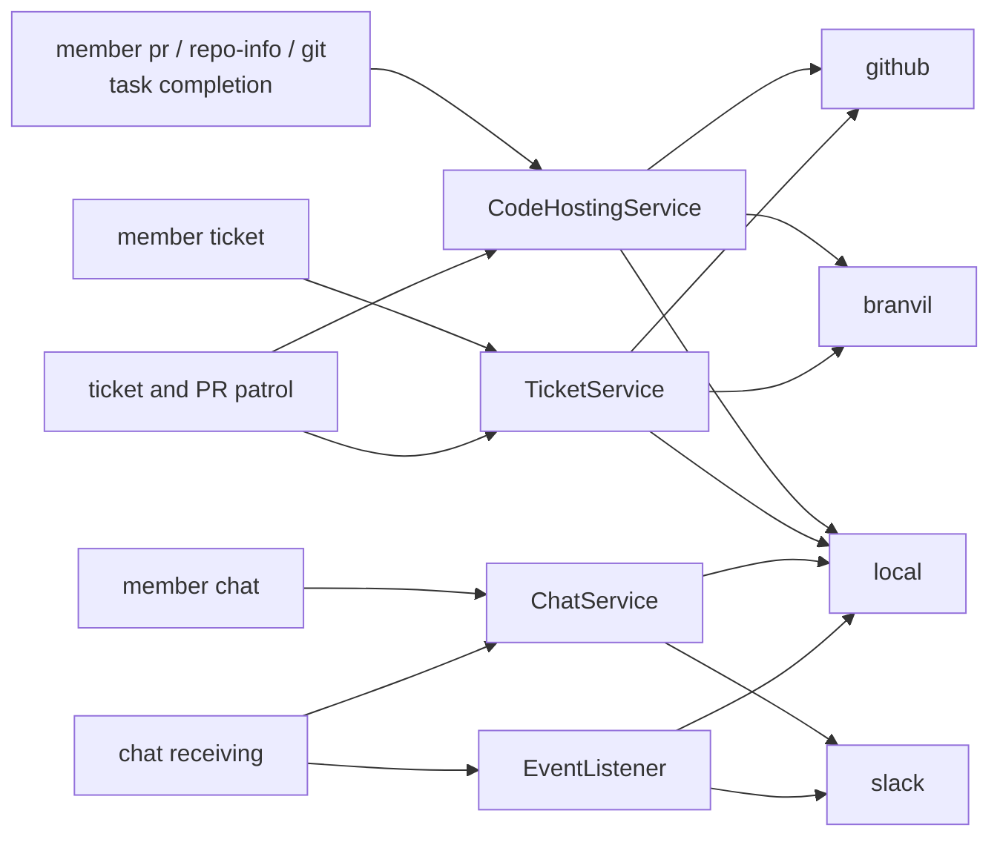

# GuildBotics Architecture

**Audience**: Developers and AI agents working on this repository.
**Scope**: System-wide concepts and boundaries. Source code is authoritative; when this
document and the implementation disagree, fix the document (see `AGENTS.md`).

---

## 1. System Overview

GuildBotics runs AI agents as _team members_ that collaborate through GitHub and Slack.
A scheduler starts one worker per active member; workers pick up work from GitHub
Projects (tickets) or from incoming Slack events, then delegate the actual
investigation/editing/judgment to an external AI CLI tool (Claude Code, Codex CLI,
Antigravity CLI, ...). External side effects that the AI agent performs _as the member_
— git pushes, GitHub comments and PRs, Slack posts, memory writes — go through a single
boundary: the `guildbotics member ...` CLI (member capability). Workflows additionally
perform a narrow set of orchestration/status writes of their own (see §3).

Users interact with the system through:

- **Desktop app** (`desktop/`, Tauri v2 + React): setup, service runtime control,
  activity history, and diagnostics over a Local API.
- **CLI** (`guildbotics ...`): headless start/run/stop, workspace selection, secrets
  migration, and the member capability entry point.
- **Interactive skill** (`skills/guildbotics/SKILL.md`): lets a user-driven coding agent
  work as a configured member in the user's current repository.

## 2. Package Map and Dependency Rules

A command runs inside its isolated environment (the guest); everything else runs
on the host. Every package is on one side of that trust boundary or shared by
both, never a mix:

```
guildbotics/
│  host
├── app_api/         # Desktop-facing Local API (FastAPI + EventBus + normalizers)
├── cli/             # Click commands (start/run/stop, workspace, secrets, member)
├── drivers/         # Scheduler, host context builder, command runner, workflow dispatcher, service control
├── setup/           # Workspace and member setup (setup_service) used by the GUI; per-provider setup lives in integrations/<provider>/setup.py
├── environment/     # The isolated environment: microVM, credential gateway, the window's host side, member broker, write-back, inference calls
├── capabilities/    # Member-side code-host/git/chat/memory operations + domain events, judgments (decisions/)
├── integrations/    # Provider descriptors and per-kind selection, the write scope, the receiving port, the patrol / readiness / ticket selection rules; GitHub / Branvil / Slack / local (the reference provider)
├── observability/   # Diagnostics and activity record writers, trace status, interactive sessions
├── workspace/       # Workspace storage: identity, config CAS
│  guest
├── guest/           # The entry inside a command's microVM, worktree copy, AI CLI adapters and turns, the AI CLI brain, the window's client
│  shared
├── commands/        # Command framework (md/py/sh/yml + inline commands)
├── intelligences/   # Brains (agno_agent / jev), LLM judgment functions, catalogs, the host-guest wire (agent_runtime/)
├── runtime/         # Context, Brain / factory abstractions, per-kind ports, invocation records
├── loader/          # YAML team/role loaders
├── entities/        # Domain models (Team, Person, Task, Message)
├── utils/           # fileio (config/storage roots), span correlation, secret store, i18n, ...
└── templates/       # Config templates, workflow commands, prompts, locales
```

The map is `[tool.importlinter]` in `pyproject.toml`, checked by `lint-imports`
in CI: it classifies every package (an unclassified one fails), and its
contracts state each side's responsibility. The host and the guest never import
each other: the host starts the guest's entry by module name
(`/opt/guildbotics/venv/bin/python -m guildbotics.guest.entry`), and what crosses between them is the
shared wire (`intelligences/agent_runtime/wire.py`). Shared code imports
neither, and neither it nor the guest imports a library only the host uses (a
server stack, the microVM SDK, the OS keychain, the inference SDK).
`tests/guildbotics/test_package_map.py` checks what imports cannot show: it
loads the brains and bundled commands the guest loads by name and finds
nothing host-only, and it finds every shared package used from the guest's
entries.

The external inference calls show how one shared interface reaches either
side: a brain calls `inference()` (`intelligences/brains/inference.py`), which
imports no implementation. The two places that build a `Context` install one —
the host's `create_context()` the calls themselves
(`environment/inference_host.py`), the guest's entry the command's window
(`guest/window.py`). The member brokers (`environment/member_broker.py`) take
the member CLI they run the same way: the environment does not import the CLI
above it, and each host entry that runs commands (`cli/run.py`, the backend's `app_api/runtime.py`) installs it with
`install_member_cli()`.

Dependency rules (the contracts in `[tool.importlinter]`, checked by `lint-imports`):

- Each side imports only downward, in the order of the map above, and the
  packages that share a step (`|`) import none of each other. The host:
  `app_api` → `cli` → `drivers | setup` → `environment` → `capabilities` →
  `integrations` → `workspace | observability`. The
  shared packages: `commands` → `intelligences` → `runtime` → `loader` →
  `entities` → `utils`. `app_api` sits above `cli` because the Desktop runs
  the member CLI in its own process for the member brokers of its commands.
- `app_api` is the top layer: no other guildbotics package may import it. Knowledge
  needed by both app_api and core (e.g. LLM provider / AI CLI tool catalogs) lives in
  core (`guildbotics/intelligences/*`); app_api only converts it to API models.
- `workspace` and `observability` take from the shared packages only `utils`.
  Observability records without knowing app_api or capability concerns; workspace is
  storage.
- Only `environment/runtime.py` imports the microVM SDK.

Responsibility boundaries between CLI / capabilities / observability / app_api /
desktop frontend — who may know provider payloads, who normalizes display titles, etc. —
are specified in `AGENTS.md` (「重要な実装ポイント > 責務境界」). This document covers the
concepts; `AGENTS.md` is the working rulebook.

## 3. Member Capability Delegation Model

The central design of GuildBotics is a three-party delegation chain, identical for the
ticket workflow, the chat workflow, and interactive skill sessions:

```
workflow (orchestration)
  -> AI CLI agent (judgment)
     -> trusted member transport
        -> guildbotics member ... CLI (external side-effect boundary)
```

- **Workflow** (`guildbotics/templates/commands/workflows/*`): builds the prompt
  payload for the selected work item and asks for one CLI agent turn with the member
  workspace as cwd. `CommandRunner` drives the turn (`commands/agent_turn.py`) when
  the execution context names `max_completion_attempts`: it retries the turn with a
  continuation prompt until the member records its completion and returns the
  response. It runs inside the command's isolated environment and reaches the run
  record only through the command's window to the host (`ClientRunLedger` in the
  environment, answered by `HostRunLedger` in `drivers/command_runner.py`, which locates
  the record from the host's own workspace). The workflow never reads or writes the
  run record itself, and it never produces work products
  (code changes, PRs, replies, review comments) and makes no writes of its own: the
  host selection around the turn — the ticket selector (`drivers/ticket_selector.py`)
  and chat selection (`capabilities/chat_selection.py`) — moves the Project lane and
  posts the rate-limit / failure status on the ticket or in the Slack thread.
- **CLI agent**: reads the ticket/thread, investigates, edits, and decides. It never
  receives GitHub/Slack tokens and never calls provider APIs directly; every external
  write goes through `guildbotics member ...`.
- **Trusted member transport**: interactive skill sessions invoke the member CLI
  directly. Every native provider session instead receives one authenticated MCP tool,
  served on the host and reached from the isolated environment, that can invoke only
  the fixed member CLI for the active person, workspace, and turn. The broker runs each
  command inside the host's GuildBotics process that runs the command (Desktop,
  `guildbotics start`, or a local `guildbotics run`), on a worker
  thread with its own working directory, streams, and invocation, instead of starting
  a CLI process per call. The broker, not the provider process, holds the turn's
  execution lease and a separately rotated per-turn grant; a command that outlasts
  the broker's timeout is reported and left to finish. Relative paths in a command
  resolve against the agent's isolated working directory.
- **Member capability** (`guildbotics/capabilities/*` + `guildbotics/cli/member.py`):
  the boundary for member actions decided by the AI agent — the only path through
  which the agent's provider operations run and the only layer that resolves the
  member's credentials for them. It records run evidence (`task_runs.py`) for each
  side effect.
- **Repository inspections** (`repository/issue_inspect`, `repository/pr_inspect`,
  `repository/pr_checks`): bundled Python commands combine the pages returned by
  the common code-hosting service. The existing member broker carries each read;
  the host selects fixed REST routes or GraphQL documents, validates continuations,
  and records observed work targets. The code host's `readiness()` (judged by
  `integrations/readiness.py` from what the provider reads) is the one readiness, shared by the
  inspection, push, and completion paths. An agent already
  inside a command calls `/opt/guildbotics/venv/bin/python -m guildbotics.guest.entry <name> <args>`
  to run a child in that environment under the main command's access contract.

Trust rules that follow from this shape:

- The workflow does not trust the agent's natural-language stdout as the result. Only
  the completion record (`member task complete` / `member chat complete`) and the run
  evidence store are authoritative.
- A reviewer finishes with `done` after submitting a verdict, including request
  changes. An author uses `asking` only when a reply is needed to continue.
  For `asking` or `blocked`, `--waiting-for` records the next member's roster
  person id. Validation checks the targets of the run's recorded comments, not
  its entry point: a ticket run can ask a reviewer on its PR. An agent must be
  reachable by the patrol on at least one such target; a human member is
  accepted without a patrol or credentials. Only waits entirely for active
  agents suppress the owner notification. When no recipient is named, the CLI
  explicitly reports that the owner will be notified.
- Ticket completion with `status=done` resolves the pull requests the run wrote to (run
  evidence), the ticket PR, and the code host's PRs that refer to the ticket
  (`ticket_pull_requests`), each only when the member authored it (the patrol resumes a
  member only for its own PRs), then revalidates each open PR against the code host's current state;
  closed and merged PRs are not readiness targets, while their CI rollup, checks, and failed
  logs remain available for inspection. Completion is rejected when observed CI fails or
  remains pending, the host requires an up-to-date head and the head is behind its base,
  or the head/base changes during the check. `behind_by` and `out_of_date` report the
  measured lag even when it does not block completion; `completion_blockers` names what
  must be resolved. Check `details` preserve the host's explanation, including merge
  conflicts without a failed job log. `rollup=no_checks` stays non-blocking when the
  current base also has no checks, while checks on the base make an empty head a
  registration-pending blocker.
  Interactive push/publish results expose compact readiness and blockers for matching open
  PRs; readiness lookup failure, including an HTTP transport failure, does not turn a
  successful push into a failed command.
  The GitHub provider ignores measured lag only when the final PR read reports
  `mergeable_state` as `clean`, `unstable`, or `has_hooks`. These states explicitly
  describe a mergeable PR in GitHub's [merge state definitions](https://docs.github.com/en/graphql/reference/pulls#mergestatestatus).
  Other states, including `blocked`, `unknown`, and missing or unrecognized values,
  conservatively require an up-to-date head. They still return checks and failed logs;
  a head with no measured lag is unaffected by merge state uncertainty.
- Credentials are resolved by the member CLI itself from the active workspace (config +
  secret store), never inherited from the agent's environment — AI CLI tools strip or
  isolate `*TOKEN*`-like variables from subprocess environments, so inheritance cannot
  be relied on anyway.
- The same capability boundary serves both non-interactive runs (scheduler-spawned
  agents) and interactive runs (a user's coding agent using the GuildBotics skill), so
  "acting as the member" means the same thing in both modes.

Member-facing agent instructions are layered so each contract has exactly one source
(shared reference → workflow envelope → trigger-specific prompt → interactive SKILL).
The layer model and its guard tests are described in `AGENTS.md`
(「member プロンプト層モデル」).

### External service ports

A member works with external services through four ports, chosen per kind by
`project.services` (`integrations/factory.py`). A port is the contract of operations
and data a caller understands without knowing the service; a provider maps it onto a
service's API.

| port | responsibility | called by |
| --- | --- | --- |
| `CodeHostingService` | repositories (git remote, default branch, push credential and scope, commit URL), pull requests (reads and writes, conversation comments, reviews, inline comments, replies, reactions), CI (readiness, failed logs, artifacts), repository information, the pull request patrol, the pull requests that refer to a ticket | `member pr / repo-info / git`, task completion, the patrol |
| `TicketService` | tickets (reads and writes, a created one put in the board's new lane, comments, reactions, the files their bodies and comments refer to) and the board (candidates, re-reading, lanes, closed work) | `member ticket`, the ticket selector, the activity import |
| `ChatService` | the chat: identity, history, posts and replies, reactions | `member chat`, the chat workflow |
| `EventListener` | receiving the chat, one connection at a time | the chat receiving runner |



What every port shares (`runtime/port.py`, `runtime/resources.py`):

- **People.** Ticket assignees, PR authors and requested reviewers, and comment,
  review and thread authors use `ActorName`: a service account name, not a
  GuildBotics person id. Each provider's descriptor exposes a credential-free
  `member_identity(person)` with its public names (including API aliases) and
  mention spelling. The patrol and author classification use that same identity.
  `member context` publishes the team roster so agents can resolve these names
  and address a teammate without guessing an id from an account name. The local
  reference provider deliberately gives members names different from their ids.
- **References.** Tickets and pull requests are named by their URLs; a read is
  `read(resource, subject)`, the subject being the item's URL or, for repository
  information, the repository's path, which the provider checks and spells (GitHub
  `owner/repo`). Comments, reviews, threads, CI jobs, artifacts, and attachments are opaque string
  ids that mean something only together with their item's URL. A work target is
  `{kind: ticket | pull_request, url, title, label}`, `label` being the short reference
  the service shows it by (GitHub `#12`); shared code never builds one from a number. A
  ticket has a `key` (its branch is `ticket/<key>`), a `tracker` (where it is kept), the
  `repository` it belongs to, if any, and its `lane` on the board.
- **Failures.** `ServiceError` (a message fit for the user, never what the service
  answered or a credential), `ServiceNotFound` (not there, or not this service's), and
  `ServiceUnsupported` (the service cannot do it at all). Optional features — reactions
  by meaning, `request_changes`, a ticket created off the board, artifacts, a ticket's
  attachments, failed logs,
  `dependency_alerts`, the pull requests of another service's ticket, a link that closes
  a ticket on a merge — raise `ServiceUnsupported` when called; an empty result means
  read and found nothing.
- **Reactions** are four meanings (`ack`, `agree`, `celebrate`, `support`) on every
  port; a provider never substitutes another reaction for one it lacks.
- **Reviews** take a verdict (`approve`, `request_changes`, `comment`) and, like inline
  comments, the head the member read: on a moved head nothing is written.
- **A workflow status** (`WorkflowStatus`) is what a run that did not finish leaves where
  its work came from; each provider carries it in its own form (a hidden comment marker,
  message metadata) and gives it back on reading. It also marks the notice a member posts
  in its explicitly selected chat channels (`chat.notify_work_stops`) when its ticket or PR work stops to wait for a person, which the
  ticket selector posts (`capabilities/work_stops.py`), so no member answers it.
- **Write scope.** Each service's configuration names a scope (an owner on GitHub); a
  write goes only to a repository or tracker directly in it (`check_path`), a push only
  to the code host's.
- **Selection rules are GuildBotics' own.** GitHub and Branvil decide which pull
  request asks something of a member (`integrations/pull_request_patrol.py`), whether a
  head may be reported complete (`integrations/readiness.py`), and whether an assigned
  ticket is a member's work now (`integrations/ticket_selection.py`) by applying these
  shared rules to the snapshots they read; the services keep only their own data, and
  the reference provider `local` goes through the same rules.

`branvil` (`integrations/branvil/`) is a code host and tickets of a
[Branvil](branvil_integration.en.md) service that every machine reaches at the same
base URL. Its API answers raw data (comments with an opaque `meta` carrying a workflow
status, reviews, threads, checks); the provider applies the rules above to it.

## 4. Workflow Invocation

Workflow start-up is normalized by `guildbotics/runtime/workflow_invocation.py`:

```python
WorkflowInvocation(command, person_id, source, trigger_type, payload, run_id, work)
# source:       routine | scheduled | event_queue | manual
# trigger_type: ticket | chat | scheduled | generic
```

`drivers/workflow_dispatcher.py` runs every invocation the same way (trace scope,
attributes, `Context.shared_state` injection), while discovery stays asymmetric on
purpose:

- **Ticket workflow** (`workflows/ticket_driven_workflow`, the default routine,
  `TICKET_WORKFLOW_COMMAND`): a routine that _polls_ the configured board (GitHub
  ProjectV2) and the code host's pull requests. The board is treated as a loose
  queue/trigger — GuildBotics does not reimplement fine-grained code-host/git
  operations around it, and there is no webhook receiver (local-first design). The
  candidates are the pull requests that ask something of the member
  (`CodeHostingService.pull_request_candidates()`), then the board's tickets
  (`TicketService.candidates()`), and each is re-read from the port it came
  from before it is dispatched; a failed or rate-limited run's status comment goes to
  that port too.
  Unanswered mentions on open tickets outside the member's assignment are also
  candidates, even outside the ready/working lanes. Providers resolve mentions;
  `ticket_selection.mention_pending` considers a member's subsequent comment an
  answer. These runs use `Work("ticket_mention", ticket_url)`: a separate conversation
  that posts a comment and completes, without preparing a repository, publishing,
  creating a PR, or moving the ticket. A response affecting the assignee's work
  mentions that assignee. An external comment addressed only to other members
  is excluded only from the assigned work's decision history. The task keeps the full
  conversation; initial work, unanswered summons, held status and linked-PR completion
  still use their own evidence. Comments without mentions keep the ordinary behavior.
  GitHub uses `bodyHTML` / `body_html` mention links resolved by the host, plus configured
  `⚙person_id` tokens outside code; raw Markdown `@` patterns are not mention evidence.
  Discovery adds a workspace mention query for Branvil, one issue Search query
  (`is:issue is:open user:<owner> mentions:<login>`) for GitHub, and a file scan for
  local. GitHub reads comments only for assigned or search-matched issues. It paginates
  search matches in updated order (100 per request, up to GitHub's 1,000-result limit),
  so answered open issues do not permanently hide page 2. Incomplete, overflowing or
  failed discovery is reported as a warning and returns no partial mention snapshot;
  assigned ticket and PR work remains available. Replies do not remove search matches;
  closing resolved issues reduces the count. Non-assigned discovery uses native
  `@login` mentions; agent tokens continue to work on assigned tickets. Assignment and
  unanswered mentions are rechecked before dispatch.
  Every route that runs it — the patrol, a scheduled command, a manual run
  (`guildbotics run`, Desktop) — selects the ticket in `drivers/ticket_selector.py`
  and runs the workflow through `TicketSelector.run`, which owns what surrounds the
  AI CLI turn: moving the ticket to the working lane, the run id and completion
  budget (`GUILDBOTICS_TICKET_MAX_ATTEMPTS`), the trace attributes that name the
  ticket, and the status comment of a failed or rate-limited run. The patrol selects
  outside any trace and dispatches each candidate in turn; a scheduled or manual run,
  or a routine that names the workflow with arguments, takes the ticket the patrol
  would take next. The workflow only runs the turn. No run waits for CI in its turn,
  whatever its work (a ticket, a chat thread, a command): when pending checks are all
  that blocks its own PRs, the member ends the run with `member checks await`, which
  leaves an `awaiting_checks` status on each such PR naming the run and its work
  (`Work`'s kind and identity, from the run's grant), and records the run's completion.
  The patrol starts a `pull_request_checks` run once the checks settle or the head
  moves; while the wait lasts, any task the PR asks for (feedback that arrives
  meanwhile too) runs in the work the status names (`Task.resumes`), so the run
  continues that work's conversation and reports where the work came from, with the
  awaiting run's summary as far as this device has it. `TicketSelector.run` ends the
  wait with a `checks_settled` status unless the resumed run awaits the checks again.
  Behavior that belongs to a run answering a chat event keys on that event, not on
  the work's kind, since a resumed run in a chat thread's work answers none.
- **Manual runs**: a command a person starts runs inside one boundary, whether the
  Desktop runs it (`AppRuntime._execute_command`) or a local `guildbotics run` does
  (`cli/run.py`): a `manual` trace, `TaskRunCoordinator.track_work(source="manual")`
  (the task-run record's start and finish, and the member's lease unless the command
  declares itself read-only), and the command's `command.started` /
  `command.finished`. The run is its trace (`run_id == trace_id`).
- **Chat workflow** (`workflows/chat_conversation_workflow`): the events the project's
  chat (`project.services.chat_service`) delivers to its listeners and backfill are
  persisted as pending events by `drivers/event_listener_runner.py`, then drained per
  member by `drivers/pending_chat_dispatcher.py`. The runner holds one listener per
  connection the provider names (`listener_key`: Slack's per app-level token), and
  places messages in time by their `occurred_at`; a message's `position` (its UTC
  time at fixed width, then its id) orders a channel's messages as text, so pending
  queues, wake cursors, and the AI CLI session's context cursor compare positions. Like the ticket
  patrol, the dispatcher selects before it starts a workflow: selection
  (`capabilities/chat_selection.py`) reads the thread, drops events that are not work
  for the member, judges the rest, and settles reaction-only and no-op outcomes itself.
  The workflow only runs the AI CLI turn for events that need a response; selection
  owns the conversation ledger around it (read marks, the thread cache, thread state,
  the run record, handoffs, failure notices).

Invariants:

- Scheduler-managed work is serial per person: one worker thread per active member
  (`drivers/task_scheduler.py`) runs scheduled, routine, and queued-event work one at
  a time. `runtime/person_lease.py` serializes non-read-only runs that use a member's
  clone across manual commands and separate GuildBotics processes with one OS advisory
  lease per person. Only `track_work` in `drivers/execution.py` takes the lease;
  every host run goes through it (the scheduler's work, and a manual command whether
  the Desktop or a local `guildbotics run` starts it). Interactive `member` commands
  take no execution lease: shared state and git operations have their own locks,
  and interactive sessions cannot use the member's clone. Nested `member` writes
  require the exact delegated lease/run identity; environment-variable presence alone
  never authorizes them.
  Read-only `member` commands declare that capability on their Click callback;
  undeclared commands fail closed as write-capable instead of being classified from
  command-name strings.
- The backend is singleton per machine: Desktop and CLI `guildbotics start` launch
  the same `guildbotics.app_api` child process. It holds
  `<machine-state-root>/run/app-api.lock` from before binding through server exit.
  The lock records owner (CLI/Desktop), PID and whether the API accepted a stop,
  so the CLI parent can distinguish an intentional forced exit from a crash.
  A failed contender reports the holder's owner to its launcher before exiting;
  Desktop's Bootstrap asks a CLI owner to stop with `guildbotics stop`.
  `service.lock` covers scheduler workers and event listeners only while active,
  including keep-awake; it carries no CLI/Desktop owner. File existence alone
  is never a liveness signal. CLI stop/kill use the local owner-token API and wait
  for the backend lock's PID; a Desktop-owned backend is stopped from Desktop.
  The CLI parent receives signals independently of the child process group: the
  first requests a graceful drain, the second cancellation, then the parent shuts
  the backend down. Failed startup and self-stopped services exit nonzero.
- A member that finishes work while messages 3 and 5 arrive in one Slack thread
  reads the unread conversation through message 5 in its next run. The oldest
  queued event starts that run; selection combines queued messages with a fresh
  provider snapshot, including intervening conversation and corrections. Historical
  context is bounded to 100 messages; unread input is kept separately so that the
  context bound cannot discard an earlier request. Both fresh and resumed AI CLI
  sessions receive the whole unread batch.
- Before judging the batch, selection records its event IDs and last
  message timestamp as `chat_batch` evidence on the task run. Completion acknowledges
  and removes those IDs. Additional `chat_updates` input is acknowledged only on
  done/asking after a subsequent chat reply, post, reaction, GitHub write, or Git publication. Blocked runs and updates
  with no later external action remain queued for another run.
  Messages not delivered to the agent also remain queued. The dispatcher reloads the thread on its next pass. Recovery
  after a recorded completion uses that saved membership, not a newly fetched
  thread, so it cannot acknowledge unread messages or repeat completed actions.
- Before replying, reacting, pushing Git commits, or writing to GitHub, a chat agent
  calls `guildbotics member chat updates --person <person>`.
  The command returns `new_messages`, `up_to_date`, `catching_up`, or `unavailable` from the durable
  queue for the run's original thread, which is the run's work as the host settled it,
  not anything its record says, without calling Slack APIs. The agent reads
  new messages and reconsiders the work. Capability write boundaries independently
  reject missing checks, unseen input, and unavailable reception. Interactive and
  ticket runs have no chat precondition.
- Socket activity wakes a separate receive task, so persistence does not wait for
  the five-second backfill scheduling cycle or an in-flight backfill request. Failed
  persistence retains the drained events for retry. Socket and backfill writes
  acquire the shared lock without blocking the event loop; contention yields and
  retries. Until received messages are saved, `catching_up` prevents publication
  and tells the agent to wait and recheck, without completing as blocked. A
  device-local heartbeat updates on state changes or every five seconds while
  unchanged; a disconnected receiver, absent record, or heartbeat older than
  15 seconds makes checking unavailable. Checking and external writes
  are separate operations: messages can still arrive after the final check.
- A failed chat run retains its queue head and retry budget. Its next attempt
  refreshes unread input, allowing a correction to change the remaining work while
  passing the run's previous action evidence to the agent. When the provider cannot
  serve a complete snapshot, dispatch waits without consuming a retry attempt;
  cached messages cannot establish whether a new correction exists. A new follower can wake a failed
  head early, once per follower cursor; provider rate-limit resets are respected.
  Other threads and members proceed independently. Exhaustion terminalizes the
  failed trigger; unacknowledged followers remain available for a later run.
- A resumed session is continued only for the same run/event and input cursor it
  last worked on. A newer batch is delivered as new input; cursor regression,
  unorderable cursors, or a run/event identity mismatch rotate the session, record
  `continuation_rejected`, and re-feed historical context with the unread batch.
- An AI CLI turn stops after three hours (`TURN_TIMEOUT_SECONDS` in
  `intelligences/agent_runtime/models.py`), with the same deadline for every
  adapter. A `timeout` failure ends the run's completion attempts immediately.
  The ticket selector leaves one explanation on the originating ticket or PR,
  and autonomous runs announce the stop in chat. A later reply makes the work
  selectable again through the usual patrol rules. The next run reuses the
  work's healthy provider session and supplies its new instructions, including
  its own completion requirement. Session IDs learned during an unfinished turn
  are saved on timeout; the session store's normal rotation limits still apply.
  `member git prepare` retains a checkout while its work has uncommitted changes,
  unpublished history, a stash, an in-progress Git operation, special index flags,
  detached HEAD, or
  linked worktrees. Other work borrows an idle checkout of the same repository,
  keeping ignored build caches such as `target` and `node_modules`; only when
  none is available does it create another clone. After a successful prepare,
  excess idle clones are removed inside the guest, keeping at most one beside
  the retained checkouts. Before deletion, a slot's record moves to the host's
  discarded registry. Cleanup failures are retried from that registry even when
  the partial deletion has already removed Git metadata; those slot IDs cannot
  be allocated again until cleanup finishes.
  Publication is established from host-fetched references and successful pushes,
  with their objects retained on the host after squash merges and ref deletion.
  Guest remote-tracking references do not establish publication. Every idle
  checkout starts at the requested remote branch or current default, including
  after a force-push or branch deletion, and tracks that remote branch explicitly.
  The same unfinished work keeps its HEAD, index and files. Host-only atomic slot
  records name the repository and current work assignment. Every run calls prepare and
  uses the returned `repo_path` and `branch` rather than a remembered path, which
  may since have been reassigned. Member commit/push reject a registered slot
  owned by another work. An empty `branch` denotes retained detached HEAD.
  These files and provider sessions live on the device that ran the turn, so
  resumption uses that device.

  Older clone directories (`clones/<person>/<repository path>`, and the earlier
  per-work hash directories) and their old plaintext checkout records are unused.
  They may be removed manually after checking for uncommitted changes,
  unpublished commits and other unfinished Git state that must first be kept.
- Rate limits from AI CLI tools are detected in the isolated environment
  (`guest/cli_agent.py`), never amplified by in-process retries
  (`commands/agent_turn.py` raises them as they are), and recorded on the host by the
  ticket selector and chat selection through shared logic
  (`capabilities/workflow_rate_limits.py`) as a `workflow.rate_limited` diagnostics
  event. Ticket selection and
  the chat pending queue defer re-entry until the provider's exact reset timestamp
  when one is available. Ticket and Slack notices and trace summaries display
  that timestamp in the host machine's local time with its UTC offset (for
  example, `2026-10-03T06:30:12Z` becomes `2026-10-03 15:30:12+09:00` in Tokyo),
  ahead of the provider's wording. `utils/rate_limit_display.py` selects the
  display value and message variant for all three. Without a readable timestamp,
  they state that the reset time is unknown; timestamps without an offset also
  count as unknown. Any provider wording is identified as the message at detection
  time. A ticket with an unknown reset time waits for a new comment before it can
  be selected again; chat retries automatically while attempts remain. The notices
  explain these different retry rules. Display formatting does not change the raw
  timestamp or the retry policy.
- Diagnostics keep provider turn success, workflow completion evidence, and dispatch
  lifecycle as separate layers (`capabilities/workflow_completion_events.py`): a
  clean provider turn without a recorded completion raises
  `workflow.completion_missing`, and the dispatcher records
  `chat_dispatch.retry_scheduled` / `chat_dispatch.abandoned`.
  `retry_scheduled` requires an actual `chat_dispatch.retry_scheduled` event;
  completion evidence alone does not imply a retry is scheduled, since the ticket
  workflow shares the same completion layer but, when its attempt budget runs out,
  the ticket selector posts an error comment instead of dispatching a retry, so missing completion
  evidence without a dispatch event resolves to `incomplete`.
- Status derivation for one execution lives in `observability/trace_status.py` and
  nowhere else: the execution index summaries and the activity history sessions ask
  the same question about the same records, so they read one implementation. A
  trace becomes success only through an event the layer that opened it records
  (`TRACE_COMPLETED_EVENT_TYPES`). `span.finished` says a single provider call
  returned, and chat selection makes an LLM decision before its agent turn starts,
  so treating that span as the trace's success showed still-running executions as
  finished. Every route that opens a `trace_scope` therefore records its own
  completion event; `tests/guildbotics/test_trace_boundaries.py` enumerates that
  population and fails on a new trace root until it declares which event ends it.
- A boundary that records the start of a run records its end however the run
  ends, cancellation included. Stopping the service cancels the work it drains
  and Ctrl-C ends an interactive member command, and neither
  `asyncio.CancelledError` nor `KeyboardInterrupt` is an `Exception`, so a
  boundary catching only `Exception` leaves `command.started` as the trace's
  last record and the execution reads as running forever. The same test
  enumerates the boundary functions and requires them to catch `BaseException`.
  How the failure is classified belongs to
  `capabilities/command_failures.command_failure_payload()` alone, because the
  `code` decides what the Desktop does with it: `cancelled` and
  `cli_agent_authentication` open no generic execution alert.

### Native agent runtime

`guest/*` holds the provider adapters behind a provider-neutral boundary for Codex
App Server and Claude Code stream-json, whose shared models are
`intelligences/agent_runtime/models.py`. It defines execution context, conversation key/record,
normalized events, terminal results, errors, explicit resume policy, process lifecycle,
and redacted diagnostics. Provider adapters own only protocol translation.

Logical conversations are keyed by person, adapter, work kind, and stable work identity
(ticket URL or Slack bot/channel/thread root), not by scheduler run. The work is the
host's to settle: the ticket selector and the chat selector fix it with its subject
when they select the trigger, a Desktop assistant names its conversation, and any other
command does its own run's manual work. The command's grant holds every turn and member
command to it, so nothing in the isolated environment names another subject or another
work's conversation. The versioned
atomic store under `agent-runtime/conversations/` persists the provider-neutral
conversation identity plus provider session/turn ids, context cursor, usage, health,
and rotation metadata. A provider process is an
execution resource; its session identity survives process restart. Exact resume never
falls back to a provider's latest session. See
`docs/native_agent_runtime.en.md` / `.ja.md` for configuration and operations.

Chat context delivery is session-aware at the brain boundary. The workflow supplies
the latest event separately from a bounded thread snapshot. A healthy session
receives only the new event; a new or rotated session receives the earlier snapshot
once.

**Paths between the host and the isolated agent environment** follow three rules.
(1) A host path means the same thing inside: every mount is at its host path and the
guest's home is the host's, so GuildBotics never rewrites a path in user content. The
one exception is Windows, where a drive becomes `/c/`; `guest_path()` in
`environment/spec.py` is the single translation point, applied to
the mount table and the working directory only. (2) A turn reaches only its working
directory, the granted directories, and what GuildBotics itself binds; everything else
is absent rather than forbidden. (3) Hand-overs go through the exchange directory
`~/Documents/GuildBotics`, which every turn is granted read-write by GuildBotics itself
(`EXCHANGE_GRANT` in `environment/contract.py`; the grants file adds
to it and cannot remove it).
What the Desktop hands a command -- a pasted image, a copy of a dropped file the
environment could not reach -- is placed in its `tmp/` for one App API session and
removed when the session ends (`app_api/command_input_files.py`); a Desktop run that
names no working directory runs in the exchange directory; and what an agent makes for
the user goes under it unless the request names a destination (a cross-cutting rule of
the member reference). Before a dropped path enters the input field the Desktop asks
`POST /commands/input-paths` whether a turn would reach it, and when it would not, the
user chooses between handing over a copy (enough for reading) and allowing the file's
directory (the path stays in the input, and the grants screen opens with that directory
in its path field, from the quick-run window too via the host's `open_main_window`), or
dismisses the file.

Host bind sources are judged in `utils/safe_paths.py` and
`environment/contract.py`: directory-relative no-follow
opens provide ancestry identities and anchor directory creation. Windows uses
relative handles and refuses reparse points. The contract's protected-path table
includes absent credential directories, device state, all registered workspace
state, and local denies. Sources containing protected state are refused; user
working directories and grants also refuse descendants. Explicit host-owned children such as member
clones remain mountable. `spec.py` checks every host mount and `runtime._volumes`
checks again before passing the same name to `Volume.bind`, without resolving
links or using tmpfs covers. `utils/workspace_state.py` owns the device registry
(`data/workspaces.json`); Desktop lists and unregisters entries through
`/device/workspaces`. Workspace admission rejects locations under the target's grants
or the exchange directory before registration or initialization.
Admission permits unavailable grant configuration so editing can repair it; command contract loading remains strict. Protected link names and
intermediate links and actual destinations share one component-wise interpretation
for mounts and input previews; loops protect every traversed name. Copy sources
must remain outside protected state. Leaf links are refused. Ancestor links are
accepted only when their parent contains fixed credential state and therefore
cannot be shared with a turn; writable grants and working directories also refuse
such links. Final reads use no-follow opens. `HostPathPermissionError` keeps the
absolute denied component, its protected owner when relevant, and localized guidance
within the common `UnsafePathError` contract.
Input-store failures belong to the store, separate from workspace selection,
and status polling retries failed startup. Member IDs are single validated path
components for both revisions and IO. Invalid stored IDs stop runtime loading with
the filename; the editor addresses existing safe directory names to rename or delete
them. The installed package always mounts at
`/opt/guildbotics/code/guildbotics` regardless of its physical directory name.

### Model effort

Effort is the single provider-neutral vocabulary for how hard a model should
think: `low` / `default` / `high`. `guildbotics/intelligences/effort.py` owns the
labels, their ordering, and the resolution order every brain shares — the
runtime channel (`session_state["effort"]`, carrying both a CLI `effort=<level>`
parameter and a workflow's automatic assessment) beats the command frontmatter,
which beats nothing at all. Because both sources arrive on one channel, a
workflow's decision keeps working when a brain slot is switched between the LLM
API and an AI CLI tool.

Translating a label into concrete settings belongs strictly to the layers that
hold provider knowledge: the definition YAML of a model or of an AI CLI tool,
and the native adapters, which each allowlist the keys they can apply. The core
understands only the common `model` key; every other key belongs to the adapter.
A level with no mapping is a warning, never a failure — mapping coverage differs
per provider, and halting a run over a missing overlay would cost more than
running without it.

Both kinds of definition have the same two layers. `parameters:` always applies,
whatever effort was asked for, and `effort.<level>` overlays it. `default` is
rejected as a mapping key, because a mapping for "do not intervene" could never
be applied; settings that should always hold belong in `parameters:`. Both also
live at the same two-level path — `models/<provider>/<slot>.yml` and
`cli_agents/<tool>/<slot>.yml`, beside the `default.yml` that names the provider
or tool in the catalog — so a slot states only what it changes and inherits the
rest, and two slots on one tool can differ.

A definition may also declare `effort_fields:`, describing the settings its
provider accepts (a key, a type, and the permitted values). That declaration is
the only thing the desktop editor reads to build typed controls and to reject an
unknown key at save time, so the editor never learns any provider's vocabulary
and a provider without a declaration simply falls back to editing raw JSON.
Descriptors resolve from the packaged definition when the workspace copy is
silent: they describe the provider, not the scope that happens to hold a file.

`default` and unspecified both request no effort overlay. A settings change
does not itself rotate a native session. Claude sends `--model` and `--effort` with
`--resume`; Grok confirms `model` and `reasoning_effort` through ACP
`session/set_config_option` after `session/new` or `session/resume`. Claude
re-sends the last recorded value for an omitted setting on resume. Grok keeps
the setting returned by its resumed session when no new value is requested.
Codex sends its settings on every `turn/start`.

Effort decisions are recorded through a safe allowlist — requested level,
resolved level, effective model id, the *names* of the applied parameters, and
an unsupported flag — never the effective parameter values, which can sit
alongside API keys and headers. The effective model id and the effort level are
the two deliberate exceptions to "names only": both are values, and both are
written. Trace / diagnostics detail shows both values. The member's CLI tool
cards and activity member column also show the last turn's model on this device.
`GET /intelligences/cli-agents/last-turns` returns that reading per member and
tool from the retained diagnostics index, including failed turns and turns with
no reported model. CLI span summaries record `agent.adapter` and
`payload.model_specified` alongside `agent.slot` and `payload.model`.
The brain determines `model_specified` from the model sent to the turn after
slot settings and effort overlays are resolved; changing settings later cannot
change the recorded classification. Rows without those facts are not inferred
from current settings.

What a turn *really* ran on is decided by the layer that holds the provider
knowledge and is carried out on the normal result path: each adapter fills
`AgentTerminalResult.model` / `.effort` with the value its provider reported
(claude's `system/init` model, copilot's confirmed session options, grok's
confirmed session options or `_x.ai/models/update.currentModelId`) or with the
one it imposed itself
(codex's validated `turn/start` settings and the catalog's advertised default
model and `defaultReasoningEffort`, claude's `--effort` flag, `agy`'s command
line), and the brain passes
them to `record_span_summary()` and logs one line per span. The conversation
record retains the last reported or imposed values (`effective_model` /
`effective_effort`, cleared on rotation). Claude re-sends recorded settings on
resume; Grok reports the values its session confirms. A turn that reports no
value retains the last known value in the record. An omitted Codex setting on a
resumed thread is reported from that record without independently verifying
that the provider retained it. A provider that reports nothing and was given
nothing leaves both empty rather than inventing an effective value; the span's
model then stays empty
too, while the `agent.slot` / `model.slot` attribute always names the slot so
traces stay searchable whatever model the slot resolved to.

## 5. Command Execution Framework

The generic execution substrate used by workflows and custom commands:

- `drivers/command_runner.py` is the host entry: it resolves the target member and
  the main command once (`prepare_command()`), opens the isolated environment the
  command, its subcommands, and their AI CLI turns all run in
  (`run_in_environment()`), and runs the command there through
  `guest/entry.py`.
- `commands/runner.py` (`CommandRunner`) is the execution machinery: it builds a
  `CommandSpec` (`commands/models.py`, via `commands/spec_factory.py`), runs child
  commands (`commands:`) first, then the main command. It is shared code, so it
  imports nothing only the host may hold (section 2).
- A `Context` is built in exactly two places: on the host by `create_context()`
  in `drivers/context.py` (integrations from `integrations/factory.py`'s
  `ServiceIntegrationFactory`, which picks each kind's provider by
  `project.services`; brains from `intelligences/brains/factory.py`'s
  `ConfiguredBrainFactory`), and in a command's isolated environment by
  `guest/entry.py` (the same brain factory, integrations through
  `WindowIntegrationFactory`). `tests/guildbotics/drivers/test_context_builders.py`
  pins the two. A context reads the team from the configuration with
  `YamlTeamLoader`, anew on every `clone_for()`: a clone's `team` is the
  configuration as it is when the clone is made, while the person it is
  given is kept as given.
- Member resolution lives in `drivers/member_context.py`. A run without an
  explicit member falls back to `Team.get_default_person_id()`: the configured
  `default_person_id` (`team/project.yml`), else the first active non-human
  member in person ID order, so only a team without any command-capable member
  raises `PersonSelectionRequiredError`. The default is treated exactly like an
  explicitly named member, so a stale one fails the same way. The App API
  reports the resolved value as `TeamSummary.default_person_id` — the Desktop
  app never picks a fallback member itself, and its default-executor select is
  therefore never empty while the team has a candidate.
- Command types (`commands/registry.py`): `.md` (LLM prompt), `.py`, `.sh`,
  `.yml`/`.yaml` (definition), plus inline commands `print`, `to_html`, `to_pdf`.
- `Context.pipe` carries stdin/stdout-like text between commands;
  `Context.shared_state` carries structured state. Their update order is workflow
  compatibility surface — change with care.
- Config file resolution (`utils/fileio.py`): primary config
  (the selected workspace's `.guildbotics/config`) → package templates.
  Localized files resolve `.<lang>` → `.en` → bare name; person-specific commands
  (`team/members/<person_id>/...`) take precedence over shared ones.
- `commands/discovery.py` is the single definition of resolution precedence
  (extension-outer in registry order, then locale, then location). Every consumer
  — the runtime, the App API `/commands/options` catalog, and the editor's shared
  command list — resolves through it, so they never disagree on the effective
  file. `commands/metadata.py` owns `inputs` / argument / Python-signature /
  placeholder parsing (domain models, not wire models); `commands/validation.py`
  validates source per format. The App API only converts these to wire models.
- Editing shared commands from the Desktop app goes through the Local API, never
  the filesystem plugin. `app_api/command_files.py` owns the editable shared root,
  opaque file IDs (URL-safe relative path; re-validated for root containment /
  extension / symlink on every call), SHA-256 revisions with optimistic
  concurrency, atomic same-directory writes, and a prospective-resolution shadow
  check on create. Persistence accepts syntactically invalid drafts so the editor
  can save work in progress; the execution-readiness guard performs format
  validation and blocks execution with `command_file_invalid_source`. Delete uses
  the same expected revision as update. Errors share one code namespace
  (`command_file_*`).
- Python command metadata lives in a static module-level `COMMAND_METADATA`
  dictionary. Catalog and validation code read it through the AST without
  importing the command, so a Python command, its metadata, its editor revision,
  and its save operation remain one physical file.
- The Desktop command editor's AI assistant separates conversation from mutation.
  Each read-only `/commands/author` request sends the complete current editor buffer,
  latest instruction, permitted operations and effective shared command sources.
  A question returns `action=answer` with no changes and bypasses source validation;
  an explicit modification request returns a reviewed `create`/`update` proposal.
  Existing-file authoring can update only the current command without renaming or
  changing its format, but may create new shared helper/wrapper commands. Desktop
  does not change the editor when either response arrives. Chat retains only a
  short proposal notice; a separate read-only editor workspace displays one
  scrollable tab per current, created, or updated file with its relative path.
  Updated files use a line-numbered inline diff with explicit additions and
  deletions. Only an explicit Apply calls `/commands/author/apply`, and a
  create-only edit proposal leaves the originally selected command open.
  That endpoint preflights every source, target and expected revision before writing
  the change set and rolls back completed writes if persistence fails. Manual
  creation still creates the normal starter source immediately. A stable
  `conversation_id` selects one provider conversation with `resume_policy=auto`,
  while every turn receives a fresh trace ID. The backend retains no chat or pending
  proposal state; the provider store keeps only session metadata needed for
  resumption and traceability.
- Run target guarantee: "save and run" sends the expected file ID + revision.
  Before running, the App API resolves the member once (request person, else the
  team default) and both the guard and the run use it, so the file that is
  checked is the file that runs. It confirms the on-disk revision matches and
  that this member's normal `resolve_named_command()` resolves to that exact file;
  a member / template / higher-priority-extension shadow or a revision mismatch is
  rejected (409 `command_file_shadowed` / `command_file_changed`), never silently
  running a different file. It also validates the selected source before loading
  execution metadata. The execution-status endpoint surfaces the same codes so
  the UI can disable the action ahead of time while leaving Save available.

See `docs/custom_command_guide.en.md` / `.ja.md` for the user-facing guide.

## 6. Member Memory

Members persist knowledge across runs as a document store (mechanism in
`capabilities/member_memory.py`; audit in `capabilities/member_memory_audit.py`).

- **Document**: 1 document = 1 directory (`meta.yml` + `body.md`) under
  `<workspace-data-root>/documents/`. `meta.yml` holds `schema_version`,
  title/summary/keywords, typed `source` entries (ticket/PR/channel/thread URLs),
  creation/update timestamps and member IDs (`created_at`/`created_by`,
  `updated_at`/`updated_by`), `pinned`, and `kind`. Both files stay under the memory file size limit
  (`MAX_MEMORY_FILE_BYTES`), checked together before either is written, so a document is
  never half old and half new.
- **Scopes**: `personal/<person_id>/` and `team/`. `memory promote` moves a document
  from personal to team.
- **Operations** (`guildbotics member memory ...`): `record`, `recall` (lexical grep
  over meta+body; `--meta-only` for source-URL pinpointing), `get`, `update`,
  `touch` ("this note actually helped" — recency only), `archive`, `promote`.
- **Recency (MRU)**: the device keeps its own record,
  `documents/recency/<device_id>.json`, of when each member last used each document
  (`record`/`update`/`touch`/`promote`; read operations do not count). The record is
  written inside the operation's shared-write span, so it is not lost when the
  best-effort audit journal fails or trims. The digest takes each document's latest
  use across the records and leaves out archived or missing documents.
  `member context` output includes a `memory` block: `digest` (top-N recent metas —
  hints that a relevant note exists) and `pinned` (always-on documents, body
  included).
- **Mechanism vs policy**: the code fixes only the mechanism above. What to record and
  how to classify it is team-owned policy, kept as a pinned team document
  (`kind: policy`) that agents may not change autonomously (human-approved updates
  only).
- **Hot-path upkeep**: every run recalls at the start (source URL first, then keyword
  OR-search) and tends memory at the end (touch what helped, update what was wrong,
  record new learnings). Cold-path maintenance of never-recalled documents is a
  planned follow-up
  ([GuildBotics/GuildBotics#272](https://github.com/GuildBotics/GuildBotics/issues/272),
  unimplemented).

## 7. Storage Roots

Path resolution separates machine state from a dedicated GuildBotics workspace
(implementation: `utils/fileio.py`). The workspace root is never inferred from
the process cwd or a member working clone.

| Root               | Location                                                                                         | Holds                                                                                                                                                          |
| ------------------ | ------------------------------------------------------------------------------------------------ | -------------------------------------------------------------------------------------------------------------------------------------------------------------- |
| Machine state root | `$HOME/.guildbotics/data` (fixed)                                                                | `active-workspace.json`, `device.json` (this device's ID and display name), `run/app-api.lock`, `run/service.lock` — state needed _before_ a workspace is chosen                  |
| Identity root      | `$HOME/.guildbotics/identity` (`GUILDBOTICS_IDENTITY_ROOT` inside a command's environment)      | The members' identities, shared by every workspace, laid out like a workspace root: `config/team/members/<person_id>/identity.yml` and the avatar beside it, `config/secrets.yml` (the index of the store of members' credentials and connection Secrets such as `BRANVIL_ADMIN_TOKEN`), `config/connections/branvil.yml` |
| Workspace root     | `--workspace`, `GUILDBOTICS_WORKSPACE_ROOT`, or the persisted active workspace                   | GuildBotics-only directory. `.guildbotics/config`, `.guildbotics/state`, `.guildbotics/local` live here                                                        |
| Config             | `<workspace>/.guildbotics/config`                                                                | project YAML, each member's participation (`team/members/<person_id>/member.yml`), `secrets.yml` (key names), transcript settings                                                                 |
| Workspace state    | `<workspace>/.guildbotics/state`                                                                 | memory documents, chat control state, task-run records, interactive session records, activity events                                                          |
| Local state        | `<workspace>/.guildbotics/local`                                                                 | diagnostics, transcripts, `secrets.json` (this machine's keychain namespace), person leases, chat message cache, member clones and the host's own repositories member git pushes from (`member_git/`), AI CLI sessions, work dirs, hotkeys, `debug.env` |

Invariants:

- Machine state root is always derived from `HOME` and never from the workspace.
- A member is split in two files. Its identity (`person_id`, `name`, `person_type`,
  `account_info`, `profile.character`, `speaking_style`, `relationships`) is the same in
  every workspace and lives under the identity root; its participation in a workspace
  (`is_active`, `profile.roles`, `message_channels`, `routine_commands`,
  `task_schedules`) and its `intelligences/` and `commands/` overrides live in that
  workspace (`IDENTITY_FIELDS` / `PARTICIPATION_FIELDS` in `entities/team.py`). Team
  loading refuses a field in the other file's place and leaves out a workspace
  member whose identity is missing. A `person_id` never changes.
- Workspace root is resolved only from `--workspace`, `GUILDBOTICS_WORKSPACE_ROOT`,
  `GUILDBOTICS_CONFIG_DIR` when it is `<ws>/.guildbotics/config`, or
  `active-workspace.json`. Missing workspace is an error for writes.
- `config/` and `state/` are the workspace's shared files, written only through the
  helpers of section 8; `local/` is this machine's own. Anything
  whose value is decided by the machine rather than the workspace belongs in `local/` —
  absolute paths, but also hotkeys, since which combinations are free depends on the OS,
  the other applications installed, and the keyboard layout.
- `GUILDBOTICS_WORKSPACE_ROOT` is published at the workspace application boundary.
  Agent execution copies that resolved value into `AgentExecutionContext`.
- There is no `GUILDBOTICS_DATA_DIR` override and no workspace `.env` file.

## 8. Shared State Writes

GuildBotics runs on one machine. Its workspace's `config/` and `state/`, and the identity
root's `config/`, are still written by several writers that do not know about each other:
the scheduler's member threads, the API handlers, the member commands the backend runs in
process, and processes of their own such as a local `guildbotics run` or
`guildbotics secrets`. `local/` is this machine's own state and is not among them.

**Identity.** A workspace and a device are each identified by a UUIDv7 minted once
(`workspace/identity.py`). The workspace ID is in `state/workspace.json`: the member CLI
names the workspace it means by it, so a backend serving another selection refuses rather
than acting there. The device ID and its display name (the host name) are in
`~/.guildbotics/data/device.json`; records carry the device ID, and the owner's Branvil git token
is labelled with it. Neither identity authenticates anything. Shared
records derive from `SharedRecord` (`workspace/identity.py`), which rejects unknown
fields, so machine-local data is kept out of them by structure rather than by a list of
forbidden field names.

**The write helpers** (`utils/shared_writes.py`). Every write to a shared path goes
through `write_shared_*`, `append_shared_text`, `delete_shared_path`,
`update_shared_text`, or `update_shared_json`; a path under `local/`, or no selected
workspace, is passed through without the lock. Shared-path membership
(`shared_relative_path`) resolves existing ancestors and appends missing components by
name, so the decision stays stable while another writer creates a parent directory; an
ancestor that cannot be inspected stops the write instead of treating the path as
machine-local. Shared JSON is written by `dump_shared_json` (sorted keys and a trailing
newline), so the same record is the same bytes.

**The shared-write lock** (`utils/shared_write_lock.py`). One lock per workspace, an OS
advisory lock, so it serializes the writers of every process. The helpers take it, so a
writer that composes what it writes without reading anything has nothing to declare and
no way to forget. What the helpers cannot infer is how far back a span reaches: a value
derived from a file's current contents has to keep the other writers out of the read too,
or the write puts back content another writer has just replaced — costing a Slack answer
for conversation control state (`state/chat_state`), or a whole document for member memory
(`state/documents`). `update_shared_text(path, apply)` and its JSON form take the lock,
read, hand the content to `apply`, and write what comes back (`None` deletes; the same
content is not written), so the span starts at the read by construction. A missing file is
passed to `apply` as `None`; other read failures stop the update without replacing the
shared file.

A few operations are wider than any single write — a journal that may be replaced rather
than appended to, a document that is two files, a policy that is at most one per directory,
a decision that reads another file — and those take the lock themselves. Within one thread
it re-enters, so such a writer declares its span without knowing whether a caller declared a
wider one. A wait that runs out raises `SharedWriteBusyError`, deliberately outside the
`OSError` family, so a caller that catches I/O errors does not report a save that is merely
in progress as an environment failure; the API answers it with 503 from one exception
handler. `tests/guildbotics/workspace/test_shared_write_lock_boundary.py` fixes the writers.

The identity root is a shared root of its own with a lock of its own. A span that changes
both a member's identity and the selected workspace's file of it takes the identity root's
lock first and the workspace's inside it (`member_write_operation`); taking them the other
way round is refused as a programming error, since it would deadlock against every span
that takes them in order.

**Optimistic locking** (`workspace/config_repository.py`). Config is the shared state a
person edits by hand, so a screen (or a second browser tab) can be composed against content
another save has since replaced. Reads report each file's Git blob ID; saves state the IDs
they expect, and a save whose expectation no longer holds is refused rather than merged. A
screen that reconciles a whole directory also states the set of paths it read, so a file
added under it since is a change like any other rather than something the save may prune
unseen. This applies to config alone; memory, conversation state, and task runs keep their
save APIs, and the lock closes their silent loss.

**One write API, not a sequence to assemble.** `ConfigRepository.write(apply, expected,
report)` takes the lock, compares, runs the caller's write, and reads the revisions to
answer with — all before releasing. The caller supplies what to write and gets back a
receipt. This is a shape, not a convenience: when the lock, the comparison, the write, and
the observation are separate parts, every writer is a place to order them wrongly or leave
one out, and there are as many such places as there are writers. Writing inside the
comparison's lock stops a refusal that has already applied half of itself; reading the
revisions there too stops an answer that pairs content the caller wrote with a revision
another writer produced. Every route that changes config goes through
`app_api/config_revisions.py`, including those with nothing to compare: comparing is
optional, being the only writer while writing is not. Which routes those are is not decided
by the URL — commands (`config/commands`) and transcript settings (`config/transcripts.yml`)
are config reached from elsewhere, and the `guildbotics secrets` CLI writes
`config/secrets.yml` from another process entirely.
`tests/guildbotics/app_api/test_config_write_boundary.py` classifies every write route.

**Record schema.** Every record written under `state/` stamps
`SHARED_RECORD_SCHEMA_VERSION` (`utils/shared_writes.py`) at the point it is written — one
constant, in `utils` because the writers span layers that cannot import each other.
`tests/guildbotics/workspace/test_shared_schema_version.py` runs the writers and checks every
record they leave. `config/secrets.yml` carries no version: it holds nothing but `keys`.

**Task runs.** The common execution boundary (`drivers/execution.py`) records each run's
start and terminal state in `state/task-runs/<run_id>/result.json`. Accepting an input
scans the member's runs and creates the record under the shared-write lock, so two workers
cannot both accept the same event or schedule slot, and a running or completed input is not
accepted again after a restart. An input is accepted again only when its run ended proving
the work did not happen: it raised or was cancelled. That next attempt continues under the
same run id, keeping the evidence earlier attempts recorded. A run whose outcome could not
be observed (`result_unknown`) keeps its input, because the work may already have taken
effect; only the user starts it again.

An autonomous operation that could not connect to its service ends as `deferred`, through
the port's `ServiceUnavailable` type. This terminal state releases its input for a later
attempt and appears as information in Activity. Its command boundary records
`command.deferred` rather than a failure; the scheduler preserves its error count and
continues other work; a deferred scheduled occurrence stays due. Manual callers and failures
after a request may have arrived retain their usual failure behavior. Every run write stamps
the current schema, including updates to an existing record.

A run record means work was taken. The ticket patrol selects its ticket outside the boundary
and claims a slot only for a ticket it dispatches, so an idle patrol leaves no record (and no
trace). A chat event is different: whether it holds work for the member is known only after
the thread has been read. The dispatcher selects it before opening a trace, so an event that
is not work for the member (an edit, its own message, one its participation excludes) leaves
neither a trace nor a record. For an event that is, it opens the trace, claims only the
event's identity (`record_start=False`), and selection records the start itself before
judging the batch; the boundary finishes only a run that started. The boundary sits inside
the work it tracks on every route, so a failure or a forced stop reaches it and the run ends
`failed` or `cancelled`, not `succeeded`. The run is its trace (`run_id == trace_id`, for the
ticket workflow too), and the boundary mirrors the trace's source and attributes into the
record at start and at finish, so the record names the run's PR / issue or chat thread
without the trace.

## 9. Secret Storage (SecretStore)

Secrets = LLM provider API keys (`models/<provider>/default.yml` `api_key_env`) and
person secrets, whose member-relative names each provider's descriptor declares
(`Provider.secret_keys`, e.g. `GITHUB_ACCESS_TOKEN` / `SLACK_BOT_TOKEN`). Non-secret
account identifiers live in the member's `identity.yml` `account_info`. Members'
credentials, and the Secrets of a provider's connection (`Provider.identity_secret_keys`,
e.g. `BRANVIL_ADMIN_TOKEN`), are kept in the identities' store
(`identity_secret_store()`), shared by every workspace; the workspace's store keeps the
rest. `guildbotics secrets --identities` manages the identities' store, and the CLI
refuses a member's key in a workspace's store. Loading into the environment reads the
identities' store, then the workspace's; a key both hold is taken from the identities'.

A member's secret keys come only from `person_secret_prefix()` in
`utils/person_id.py` (prefix: replace `-` with `_`, uppercase, then `_`); a key is
that prefix followed by the member-relative name. It returns the prefix a member
owns alone and raises `PersonEnvPrefixConflictError` naming the colliding config
files when another stored identity, including an invalid one awaiting repair,
derives the same prefix. The namespace is the identities', not a workspace's: two
members that never share a workspace still collide. Creation rejects an occupied prefix;
team loading reports the colliding config files and refuses execution. Runtime
key resolution and bulk loading do not read ambiguous member secrets
(`ambiguous_person_secret()`: the member of the longest prefix a key has is
shared). Setup keeps these members editable with secret-presence flags and key
names cleared: deleting one preserves the ambiguous keys.
`tests/guildbotics/test_person_secret_boundary.py` classifies every secret store
access and member key spelling in the package.

- **Backend** (`utils/secret_store.py`): OS keychain only. The workspace keeps a
  non-secret index in `.guildbotics/config/secrets.yml`, `keys: [<name>, ...]` and
  nothing else, so no value has a place to go. `.guildbotics/local/secrets.json` holds
  this machine's keychain namespace (`store_id`, the service `GuildBotics/<store_id>`).
  Only a missing record starts a new namespace, and only a missing index is empty:
  one that cannot be read, parsed, or has another shape is a `SecretStoreError`
  before anything is written, because a fresh start would leave the values where
  nothing records them.
  There is no env-file backend and no `GUILDBOTICS_SECRETS_BACKEND` switch. A
  missing or locked keychain is an error. Machine moves use `guildbotics secrets
  export` / `import` (dotenv is an exchange format only). `secrets set --from-file`
  absorbs a PEM or other file into the keychain.
- **Keychain adapters** (`utils/keychain.py`): `KeyringSecretStore` owns the
  workspace index and delegates value I/O to a platform adapter. macOS and Linux
  retain the Python keyring backend. Windows uses `utils/windows_credentials.py`
  and writes UTF-8 opaque blobs to a GuildBotics-specific Credential Manager
  namespace, preserving the 2,560-byte capacity for ASCII-heavy PEM keys. Batch
  imports validate every value before the first write.
- **Resolution priority** at process start: real environment variables > OS keychain.
  Allowlisted debug settings (`LOG_LEVEL`, `AGNO_DEBUG`) come from
  `local/debug.env`. GuildBotics never reads a workspace `.env`.
- **Exception**: `*_GITHUB_PRIVATE_KEY` (GitHub App PEM content) is _never_ injected
  into the environment. Consumers read it on demand through the secret store.
  A PEM from GitHub App auto-registration stays in the Local API's memory: the
  member save names the registration, and the API stores its key in the
  keychain and discards the registration.
- **Tests**: an autouse `fake_keyring` fixture installs an in-memory keychain so
  tests never touch the developer's real OS store.

## 10. Observability and Diagnostics

`guildbotics/observability/` is the recording substrate (depends only on `utils`):

- **Correlation**: `trace_scope` / `span_scope` / `correlation_fields` /
  `set_attributes` correlate everything that happens in one execution — a manual
  command, one scheduler cycle, one batch of unread chat messages — under a single `trace_id`,
  with spans for LLM / AI CLI tool calls and `call_id` correlation.
  Trace attributes carry structured search keys (e.g. `target.url`, `target.label`).
  Work targets use `target.provider/kind/url/label/title/action`; chats use
  `chat.provider/channel/thread/message`. Fact event types name their subject:
  `repository.push`, `pull_request.item`, `ticket.item`, `ticket.comment`,
  `target.recorded`, and `target.scope_refused`.
  Idle ticket patrols (a routine cycle whose selector finds no actionable ticket) open
  no trace and leave no records; liveness is exposed instead as a per-member patrol
  heartbeat (`member_routines`) in the scheduler's runtime status.
- **Persistence**: `run/diagnostics.jsonl` is a small searchable index containing session
  pointers, execution boundaries, span summaries, and domain events. Complete events, logs,
  spans, and request/response I/O are stored as one JSONL transcript per execution or system
  session under `run/sessions/` (`session_transcripts.py`). `standard` detail omits high-volume
  thinking/delta events and bounds AI CLI tool stderr to its final 8 KiB; `full` keeps them.
  Session transcripts default to 30-day retention. Memory audit remains a separate store
  under `documents/memory_events/<device_id>.jsonl`: the device appends to and trims its
  own bounded journal, and readers merge the journals in timestamp order.
- **Lifecycle records, fact events**: one execution is one shared record. A workflow
  run is its task-run record (`state/task-runs/<trace_id>/result.json`); an interactive
  member CLI session is its session record (`state/sessions/<trace_id>.json`,
  `interactive_sessions.py`), rewritten at the end of every command with the session's
  first command, its last command's result, and the first `github.*` attributes its
  commands recorded. The shared activity events (`activity_event_store.py`) carry only
  the facts recorded inside an execution — provider domain outcomes, completion
  evidence, dispatch decisions — never the `command.*` /
  `member.command.*` boundary events, which stay in local diagnostics. The Activity
  History therefore reads one record per execution instead of folding every command
  it ran. Two consequences are
  deliberate: an interactive session's status is its last command's result rather than
  "failed once, failed forever", and an `ERROR` log no longer marks a session failed
  (logs are local; the diagnostics index still folds them for its own list).
- **Consumption**: `app_api` reads the lifecycle records, the shared activity events,
  the memory audit, and — from local diagnostics — only the `target.recorded` events,
  and converts provider payloads into provider-neutral activity
  events/links for the desktop Activity History (`activity_events.py`,
  `activity_links.py`). Display normalization lives _only_ there — not in
  observability, not in the frontend — with two exceptions resolved once next to the
  records, because the execution list and the activity timeline ask the same question
  about the same execution: a trace's status (`trace_status.py`, which the timeline
  seeds with the lifecycle record through `TraceStatus.observe`) and its title
  (`trace_title.py`). A trace is titled by the first PR / issue recorded inside it
  (`target.title`): the ticket selector declares it before the turn, and a chat workflow
  acquires it when the member CLI, running inside the same trace (`join_trace`, handed
  over in the member invocation), records a `target.recorded`. A read
  (`inspect`) declares the target too but, like a memory read, never becomes an
  activity link. Manual command runs (`source: manual`, from the Desktop or a local
  `guildbotics run`) are excluded from the session timeline because they fire constantly; anything they
  changed still appears as an activity event. The Desktop AI assistants are such runs
  too — the agent work kind scopes the provider conversation, not the trace — so they
  are filterable in diagnostics and absent from the timeline. Diagnostics keeps every source.
- **System health alerts**: successful and failed verify/scenario-diagnostics runs are
  recorded as structured diagnostics events. `app_api/system_alerts.py` folds those
  events together with command outcomes, rate-limit events, and current runtime state
  into deduplicated unresolved alerts. The materialized state is retained separately
  in `<workspace-data-root>/run/system-alerts.json`, so diagnostics rotation does not
  discard an unresolved condition. A durable JSONL cursor advances across newly
  appended records and folds only alert-relevant events; processed-record hashes are
  not retained, so logs and spans do not grow the state file. Credential checks and
  runtime failures open on the first failure; a matching successful check/execution or
  removal of the affected member/provider closes the alert. A user may also dismiss the
  current occurrence; a later occurrence of the same cause opens it again. Provider adapters
  normalize structured authentication failures to `credential.failed`, allowing a
  workflow-time failure to become critical without waiting for diagnostics, and record
  `credential.verified` when a later turn of the same member is answered, which closes
  that alert without a diagnostics run. Inference with a workspace API key (an LLM
  provider's through agno, Jev's) is recorded where the call is made,
  `environment/inference_host.py`: agno keeps a failed run and answers with the error's
  text, so the provider's own error is taken from the model instance and the call
  raises `InferenceFailure` instead. Every such call ends its span naming the key
  (`credential.provider` `llm` / `jev`, `llm.provider`) and, when refused, why
  (`error.category`: `authentication`, `credit`, `rate_limit`, `other`, decided by
  the status and error type the provider reported in `llm_providers.classify_failure`),
  with the status and what the provider answered (`error.status_code`,
  `error.response`). The answer is recorded with the key the call used and the
  workspace's secrets masked and bounded (`redact_for_sharing()`), because the
  records are mounted into the environment of a command that inspects
  diagnostics; it never crosses the command window, which carries only the
  failure's kind, status, and category.
  The span is the record: the alert is one per provider account
  (`inference:llm:<provider>`, `inference:jev:`), opened by an `authentication` or
  `credit` refusal and closed by the next call of the same key that succeeds; a rate
  limit passes by itself and opens none. It is keyed apart from the verify and
  diagnostics checks of whether the key is configured (`credential:llm:<provider>`),
  which say nothing of whether the provider takes it and so never settle a refusal;
  the converse holds, so a call that succeeds also closes the key's missing-key alert. The setup screen shows each key's latest
  refusal, of any category, from the same spans (`/intelligences/inference-failures`).
  The desktop
  polls `/system-alerts` and renders the result above every route with links to
  diagnostics, setup, service state, or the correlated trace. Provider classification
  remains in the backend; the frontend only translates stable alert codes.

- **Read-only diagnostics queries**: `guildbotics diagnostics traces | trace <id> | system`
  (`guildbotics/cli/diagnostics.py`) reads the index and transcripts through
  `DiagnosticsStore` and emits raw records as JSON. It is a top-level group rather than
  a `member` subgroup because a diagnostics query is workspace-scoped, not member-scoped:
  it needs no acting member, takes no execution lease, and `--person` is a filter over the
  records' `person_id`, not an identity. It never calls `start_maintenance()`, so reading
  cannot rotate or prune what it reads, and it carries no display normalization — record
  meaning is taught to its consumers instead. `--query` searches each candidate's full
  transcript, not just the index, because the text a failure describes itself with lives
  in log and I/O records that the index never stores. Desktop assistant traces are excluded by
  default so the troubleshooting agent does not investigate its own conversations.

## 11. Desktop App

`desktop/` is a Tauri v2 + React (Mantine, TanStack Query) frontend; the repository is
a monorepo on purpose.

- **Local API boundary**: the GUI never reimplements the Python engine. The backend
  (`python -m guildbotics.app_api`, FastAPI) serves both the API under `/api` (REST,
  and the `/api/events` WebSocket) and the screens themselves (the Vite build of
  `desktop/`: `/`, `/quick.html`, `/assets/*`, and `/-/enter` and `/-/authorize`, which
  the main page tells apart by path; `app_api/ui.py`). It listens on loopback only, on
  one fixed port (`GUILDBOTICS_SERVER_PORT`, 8765 by default), which every program of
  the machine reads from the environment: the server, its CLI clients, the Desktop
  that launches it, and the Vite dev server that proxies `/api` to it. GuildBotics runs
  on one machine, the Hub; other machines reach it from a browser through SSH forwarding
  to the same port (`scripts/hub-forward.sh` / `.ps1`, plain OpenSSH user services). The
  screens therefore work the same in any browser and in the Desktop windows.
- **Authentication** (`app_api/auth.py`, as Branvil's "Entering the GUI"): there is one
  person, the owner, and no sign-in screen.
  - The server keeps its records in `~/.guildbotics/data/server/<port>/` (`0700`):
    `owner.token` (`0600`) and `auth.json` (tokens and sessions, by SHA-256 only). A
    token is `gbt_<id>_<secret>`. Whoever can read `owner.token` is the owner. At every
    start the server checks that the file still authenticates; when it is missing or
    does not, it revokes the previous file token, ends every session, and writes a new
    one. Only the process that bound the port opens these records, so a second
    backend whose bind fails changes nothing.
  - A client holding an owner token (`Authorization: Bearer`) asks
    `POST /api/session/links` for an entry link, `{base}/-/enter#<code>` (32 random
    bytes, single use, 60 s, in memory as its hash; `?next=` names a page of this
    server). The code is in the fragment, so it is in no request line, log, or
    `Referer`. The page removes it from the address bar and exchanges it at
    `POST /api/session` for the session cookie `guildbotics_session_<port>` (`HttpOnly`,
    `SameSite=Strict`, 30 days; the port is in the name because cookies are not
    separated by port, which also keeps it apart from Branvil's `branvil_session`) and
    its CSRF value. As in Branvil, a session ends after its 30 days however much it is
    used, and the screen then says how to enter again. Every non-GET
    request made with the cookie must carry `X-GuildBotics-CSRF`, else
    `403 csrf_mismatch`. `guildbotics open [--print]` is that client on the command
    line; the Desktop host is another.
  - A machine that cannot read `owner.token` gets an owner token of its own through the
    consent screen: `guildbotics connect` listens on a loopback port and opens
    `/-/authorize` with its name, that `redirect_uri`, a `state`, and a PKCE `S256`
    challenge; the owner allows it with a session (`POST /api/apps/authorizations`), and
    the CLI exchanges the single-use, 60-second code bound to its name, address, and
    challenge at `POST /api/apps/token` for a token labelled `app:<client>`, replacing
    that client's previous one. The token is kept in the machine's OS keychain
    (service `guildbotics-server`). `guildbotics open` offers `owner.token`, then that
    token, and uses the first the server proves it knows (`utils/local_api.client_tokens`):
    an owner file outlives its server, and the port may lead to the Hub by then. `run`
    delegation hands over this machine's paths and secrets, so it offers `owner.token`
    alone: only the server running on this machine knows it.
  - The guard runs before every route, the screens included: `Host` must be
    `127.0.0.1`, `localhost`, or `[::1]` with the port (else `421 misdirected`, against
    DNS rebinding), and an `Origin` must be that same origin (else
    `403 origin_mismatch`). No CORS header is ever sent. Every response carries
    `Content-Security-Policy` (`script-src 'self'`, `form-action 'self'`,
    `frame-ancestors 'none'`), `X-Frame-Options: DENY`, `nosniff`, and
    `Referrer-Policy: no-referrer`; a provider page that must post a form elsewhere
    (the GitHub App manifest) widens `form-action` to that one origin and runs no script.
    The WebSocket needs the session cookie and the server's own `Origin`.
  - Unauthenticated are only the proof below, the two code exchanges, the screens
    (which hold no data), and the provider pages a browser comes back to from another
    site, which act on their unguessable `state`.
- **Who receives a token**: a loopback port is not owned by an OS user, so a token goes
  only to a process that showed it holds the port or knows the token.
  - Desktop starts the sidecar on the fixed port (`GUILDBOTICS_SERVER_PORT`, 8765 by
    default), which the sidecar reads from the environment it inherits. The sidecar
    binds, listens, writes its owner token file, and then announces the port as the
    only line its stdout ever carries (`GUILDBOTICS_APP_API_PORT=<port>`); afterwards
    stdout is stderr. It announces before loading the workspace, whose secrets can wait
    on a keychain prompt, so the host's deadline measures binding only. The host keeps
    one connection state (`Starting` / `Ready` / `Closed`) that only a notice for the
    port it asked for makes `Ready`; only then does it read
    `~/.guildbotics/data/server/<port>/owner.token` and send it as
    `Authorization: Bearer` (`/api/session/links`, `/api/shutdown`,
    `/api/scheduler/status`). A missing notice after 45 seconds, a notice for another
    port or a second one, or the sidecar's exit closes it for good, kills the sidecar,
    and sends every window back to its bundled bootstrap page.
  - Both windows first load that page (`bootstrap.html`; the quick window with
    `?next=/quick.html`). It calls `backend_entry`: `null` while the sidecar starts, a
    fresh entry link once it is ready (an entry link works once, so the host asks for
    one each time), or why there is none. The page replaces itself with the link, so
    the windows show the UI the backend serves and hold a session cookie like any
    browser. Tauri treats that origin as remote: the host grants it what
    `capabilities/default.json` grants the bundled UI (a runtime capability for
    `http://127.0.0.1:<port>/*`), while the bootstrap page's own commands
    (`backend_entry`, `bootstrap_log`, `restart_app`) stay with the bundled page. The
    sidecar starts again only with the app, so the bootstrap page shows why it stopped
    and offers to restart the app (`restart_app`). A window whose session has ended
    goes back to its bootstrap page (`enter_again`, which navigates only to the page the
    host recorded for that window) and enters again. While the App is not shown, quit
    requests go straight to `quit_app`.
  - Host clients (`guildbotics run` delegation and `guildbotics open`) go through `utils/local_api.py`'s `connect_local_api()`. For each token it
    offers, it first posts the token's id and a fresh 32-byte nonce to
    `/api/local-api/proof`, which takes no
    token and answers `HMAC-SHA256(sha256(secret), "guildbotics-local-api-proof\n" +
    nonce + "\n" + id)`. Only a matching proof attaches the token; a process that took
    the port while the server was down knows no digest, so it, a replayed answer, a
    malformed answer, or a timeout gets neither the token nor anything it guards. A
    health answer is no evidence.
  - Remaining limits: a port the genuine server leaves after a client's proof can be
    taken before the client's next connection (later requests usually reuse the proved
    connection). A browser redirected back by GitHub App registration or Branvil's
    consent reaches the port even after the server exited, carrying a one-time code.
- **Runtime lifecycle**: the backend is the sole composition root for member workers
  and event listeners. Both Desktop and CLI
  `guildbotics start` launch it (the module in development, the sibling bundled
  `guildbotics-app-api` when packaged), passing their parent PID to the watchdog.
  The backend owns `app-api.lock` for its lifetime and `service.lock` only while
  services run. The CLI waits for its child's port notice, then uses the local
  owner-token API; `--only` selects scheduler sources. `/scheduler/stop` defaults
  to waiting; CLI stop/kill use `wait=false` to acknowledge the stop before draining
  and wait for the process themselves, escalating with `force=true` if needed.
- **Packaging**: `scripts/desktop-build-backend.sh` builds the Local API
  (`guildbotics-app-api`) and the CLI (`guildbotics`) as one PyInstaller directory that
  shares `_internal/`, into `desktop/src-tauri/binaries/guildbotics/` with a `build-id`.
  It carries the screens the Local API serves, the Vite build of `desktop/`, in
  `_internal/desktop/dist` (beside `_internal/guildbotics/` as in a checkout), so the
  screens are built first.
  Tauri bundles it as a resource and the app starts the Local API from it. The CLI is
  copied once per build into `~/.guildbotics/programs/<build-id>/`, never modified
  afterwards, and `~/.guildbotics/bin` is a link to the current one (a junction on
  Windows). While a process still runs from an older build the switch waits for the next
  launch, and an old build is removed only on a launch after the switch, once nothing
  runs from it (a program just started through `bin` may not hold its lock yet): the CLI holds a shared lock on its executable (the PyInstaller runtime hook
  `desktop/sidecar/hold_program_lock.py`), and on Windows a running executable cannot be
  opened for writing. A one-file build unpacks everything on every start, which cost
  seconds per CLI call. The
  app also installs a `~/.local/bin/guildbotics` shim and the GuildBotics skill for
  interactive agents. External AI CLI tools are _not_ bundled — the GUI detects,
  verifies, and configures them only.
- **This machine**: the settings section for what belongs to the machine rather than to a
  workspace — the registered workspaces (`/device/workspaces`) — listed in the settings nav
  under its own "This machine" group and reachable before any workspace is selected.
- **Config saves are explicit and revision-checked**: every settings screen saves on a
  button, and sends back the revisions its read reported. A refused save reloads the screen
  instead of resending, since resending is exactly the overwrite that was refused.
- **Global hotkeys and the quick-run window**: assignments are device-local
  (`.guildbotics/local/hotkeys.yml`, served by `GET`/`PUT /hotkeys`) because which
  combinations are free is a property of the machine, not of the workspace.
  `guildbotics/app_api/hotkeys.py`
  owns the accelerator grammar and the conflict rules; the Tauri host only registers
  what the frontend hands it. Pressing a combination reads clipboard text or an image
  and opens a resizable frameless window (`quick.html`); clipboard images are persisted
  through the same session-scoped input-file store used by paste. The generic hotkey
  offers a command picker, while a per-command hotkey runs straight away unless a
  required input is missing, in which case the window waits. Because hotkeys only fire
  while the process lives, closing a window hides it and the app stays resident in the
  menu bar. Every Quit the app owns (the tray item, and on macOS the app menu with its
  Cmd+Q, which replaces Tauri's default menu because that one sends `terminate:`) asks
  the frontend's "work still running" guard first; a failed status read asks too
  rather than quitting. Quits that arrive from outside the app on macOS (the Dock's
  Quit, logout) come as a quit Apple Event, which tao's delegate does not get to
  refuse, so the host adds `applicationShouldTerminate:` to it: the quit is cancelled
  and handed to the same guard while the backend reports work (or cannot be read), and
  let through when it is idle, so an idle app never holds up a logout. "Is there work"
  has one answer, `RuntimeStatus.has_active_work`, which the workspace switch, the
  frontend guard, and the host all read. A force quit or a crash still bypasses all of
  this, so the guard is not what protects the backend: on `RunEvent::Exit`, which every
  orderly route passes through, the host requests `POST /shutdown`, waits for the
  sidecar to finish its lifespan teardown, and kills it only if that fails. How long
  that wait is comes from the backend (`TEARDOWN_BUDGET_SECONDS`, returned with the
  accepted shutdown), so the host never cuts short a teardown still within its limits.
- **AI assistants**: the command editor and the diagnostics screen each host a
  conversational assistant. Each is a bundled command (`assistants/author_command`,
  `assistants/troubleshoot`) that runs through the same path as any command the Desktop
  runs (`AppRuntime._execute_command` → `prepare_command` → `run_main_command`): once
  the run is accepted for the workspace, the API resolves the command exactly once,
  decides its slot and tracking on that runner, builds the command's JSON input from
  what it declares, and runs that same runner under a fresh trace labelled
  `author:<command>` / `troubleshoot:<trace_id|view>`, and reads the typed model the
  command returns. The API names the assistant's conversation as the run's work
  (`PreparedCommand.work`), so every turn of it resumes the provider's own session. Both declare themselves read-only (`read_only:
  true`), and a read-only command is confined by its isolated environment, not by its
  prompt or its provider: the whole run, every turn included, inherits the declaration, the
  environment spec mounts every host directory read-only with an empty working
  directory and lets the network reach only the provider's API and the member broker,
  and the run takes no member execution lease, no manual-command slot and is tracked
  non-exclusively, though it still keeps the workspace from switching until it ends.
  Its native adapters belong to its own run, so it never closes another run's turn.
  So it stays usable while another command or that member's scheduled
  work runs — which is exactly when its logs are worth asking about. Command authoring
  can inspect the effective shared command sources and return structured proposals,
  which the command validates and sends back once for correction; only the separate
  explicit apply endpoint writes them. On the frontend,
  `desktop/src/assistant/` owns the shared chat panel and conversation state; each screen
  keeps its own mutation. Conversations are never persisted on this side.
- **Troubleshooting assistant**: opened from the diagnostics screen, it answers questions
  about recorded executions. It is given only the question, the focused view and where to
  look; it gathers its own evidence by reading the recorded runs and the workspace
  configuration, which its command declares it inspects (`inspects`) and its environment
  mounts read-only. This keeps
  prompts small and lets it follow leads into other executions and into the commands and
  settings they ran with. What it reads
  is untrusted — logs carry GitHub issue bodies, chat messages and external tool output —
  which is why the read-only confinement above is enforced rather than requested. It returns
  the answer plus the trace ids it read, and the backend drops any id that was never
  recorded before the frontend turns it into a link. The record detail and the assistant
  share one mutually exclusive right-edge panel, so two drawers never fight over the same
  strip; the assistant is non-modal, so the executions list behind it stays clickable.
- **Support targets**: macOS Apple Silicon (DMG) and Linux x86_64 (`.deb` / AppImage).
  The CLI remains the fallback everywhere else.

See `desktop/README.md` for build, development, and test instructions.

## 12. Domain Model Notes

Core entities live in `guildbotics/entities/` (`Team`, `Person`, `Task`, `Message`).
Two Person distinctions matter architecturally:

- **AI members** are execution subjects: active members get a scheduler worker, Slack
  subscriptions, credentials, and an intelligence (brain) configuration.
- **Human members** are _references to real people_ (roles, Slack user id, GitHub
  username, avatar) used for handoff candidates and assignee mapping. They are saved
  with `is_active: false`, are never scheduled, hold no bot/app credentials, and the
  desktop settings UI intentionally hides all agent-execution fields for them. Treat
  any path that would execute a human member as a boundary bug, not a feature. The
  rule is enforced in one place, `ensure_execution_subject()` in
  `guildbotics/drivers/member_context.py`, applied by command execution
  (`guildbotics/drivers/command_runner.py`) and by member capability resolution
  (`resolve_member_context()` in `drivers/context.py`). Every
  `guildbotics member ...` command that acts as a member resolves it that way,
  so the rejection happens before any capability runs; the commands that do not act as a member (`member help`, and
  `member task status`, which ignores `--person`) never resolve one.

## 13. Extension Points

- **New brain**: implement `Brain`, register via the intelligence mappings
  (`guildbotics/templates/intelligences/*.yml`).
- **New AI CLI tool**: implement a native adapter under
  `guest/`, register it in `guest/factory.py`, and add
  its catalog entry to `CLI_AGENTS` in `intelligences/cli_agents.py` with a matching
  `templates/intelligences/cli_agents/<tool>/default.yml`. There is no YAML-only path:
  a tool without an adapter cannot run. Declare in its catalog entry how the tool is
  provisioned into the isolated agent environment (`CliAgentProvision`: the pinned
  npm package, its state root, which entries persist, its login command, its API
  domains); the access contract (`environment/contract.py`) is
  enforced by the environment (`environment/`), not translated per
  adapter.
- **New command type**: subclass `CommandBase` with `extensions` / `inline_key`; the
  registry picks it up (`commands/registry.py`).
- **New integration**: implement the ports of the kinds the provider serves
  (`CodeHostingService` and `TicketService` with the item shapes of
  `runtime/resources.py`, `ChatService` with its `EventListener`; all in `runtime/` but
  the listener, at the root of `integrations/`) under
  `integrations/<provider>/`, failing only with the ports' failures
  (`runtime/port.py`) and passing every write through `check_path`
  (`integrations/repository_scope.py`) with the scope of its own service. Describe it with a `Provider`
  (`integrations/provider.py`: its kinds -- for a chat, the `Chat` of its service,
  listener, and `listener_key` --, the secret names and `account_info` keys a member
  needs, `verify`, `diagnose`, `credentialed`) and add it to `PROVIDERS` in
  `integrations/factory.py`, which selects it by its `project.services` name; add the
  package to the `providers-behind-the-factory` import contract. The ports' contract
  tests (`tests/guildbotics/integrations/contracts/`) then run against it, and the
  descriptor test holds its declared keys to what its package reads.
- **New activity event/link kind**: add the recording payload (capability →
  observability), the normalizer/API model (app_api), and the frontend rendering
  (desktop) as three separate responsibilities.

## 14. Related Documents

- `AGENTS.md` — working rules for this repository: responsibility boundaries, CI
  commands, testing strategy, prompt layer model.
- `README.md` / `README.ja.md` — user-facing setup and usage.
- `docs/custom_command_guide.en.md` / `.ja.md` — custom command development guide.
- `desktop/README.md` — desktop build/dev/test guide.
